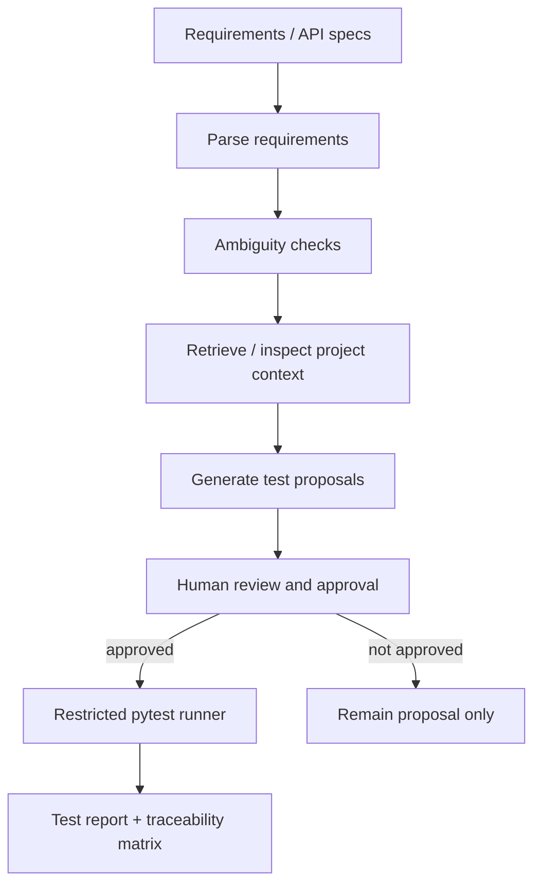

# DevAssure

**Requirement traceability and controlled AI-assisted test planning.**

DevAssure is a software-engineering lifecycle prototype. Its offline baseline is a deterministic, policy-driven tool workflow rather than an open-ended LLM agent; an LLM adapter can be added behind these boundaries after evaluation criteria are established. It parses requirement statements, flags ambiguous wording, proposes reviewable test scaffolds, maps candidate test names to requirements, and offers a human-approved test runner restricted to an existing Python file within a selected workspace.

## Implemented capabilities

- Requirement extraction with stable local IDs.
- Lexical retrieval over explicitly supplied code/specification snippets, including source path and line attribution.
- Secret-path exclusions for `.env`, private keys, credentials, virtual environments and generated folders.
- Simple ambiguity heuristics for terms such as "fast", "secure" and "appropriate".
- Deterministic test proposal generation (not a hosted LLM agent).
- Traceability matrix with token-overlap matches and uncovered requirements.
- Bounded tool-calling workflow with an explicit allowlist of requirement extraction, ambiguity checks, project-context retrieval, proposal generation and traceability tools.
- Human approval gate before execution.
- Subprocess invocation with a fixed argument list, no shell, workspace path checks and timeout.
- FastAPI analysis and execution endpoints.
- Synthetic comparison script and pytest/CI configuration.

## Architecture



## Quick start

```bash
python -m venv .venv
source .venv/bin/activate  # Windows: .venv\Scripts\activate
pip install -e '.[dev]'
pytest -q
python scripts/demo_analysis.py
uvicorn devassure.api:app --reload --port 8002
```

POST to `/analyze` with optional selected context files and existing test names:
```json
{
  "specification": "The API must validate request payloads.\nThe service shall record an audit event.",
  "context_files": [
    {"path": "src/api.py", "content": "Request schema validates payload fields."}
  ],
  "test_names": ["test_payload_validation"]
}
```
The context retriever accepts only the files supplied in the request; it does not scan arbitrary host paths. Sensitive path names are excluded. Review the context-selection policy before connecting this to a real repository.

## Controlled test execution

The default workflow only returns proposals. To run an existing test file from the workspace, the caller must explicitly set `approved=true` on `/execute`. The runner uses `sys.executable -m pytest`, `shell=False`, a timeout and path containment checks. This is a safety improvement, not a full sandbox: tests are Python programs and can still access the permissions of the process. Run untrusted code inside a hardened container with a non-root user, read-only mounts, network disabled and resource limits.

## Experiment

```bash
python scripts/run_ab.py
```

The included comparison uses a tiny synthetic test-source snippet to compare name-only mapping against mapping augmented by retrieved test context. It is a deterministic traceability proxy, not an LLM test generation experiment. A valid research evaluation should compare requirement-only and retrieval-grounded test generation under matched model settings, then assess test validity and seeded-defect detection on a held-out project suite. The present code does not claim to measure those outcomes.

## Limitations

- Requirement extraction is rule-based; it misses statements without modal verbs and may split complex requirements poorly.
- Traceability is token-overlap-based; semantic retrieval and human adjudication are future extensions.
- Proposed assertions are scaffolds and are not necessarily executable against a real system.
- The approval runner is not a security sandbox.
- Human review effort is not measured.
- No production LLM or multi-agent execution is included in the offline baseline.

## CV wording after verification

- Built a requirements-analysis and traceability workflow that extracts requirement statements, flags ambiguous acceptance criteria and maps proposed tests to requirement identifiers.
- Implemented a human-approved pytest execution path with workspace-bound file checks, fixed subprocess arguments and execution timeouts.
- Added FastAPI interfaces, deterministic fixtures and reproducible traceability experiments.

Do not claim LLM agent test-generation performance until that integration and evaluation have actually been implemented.
